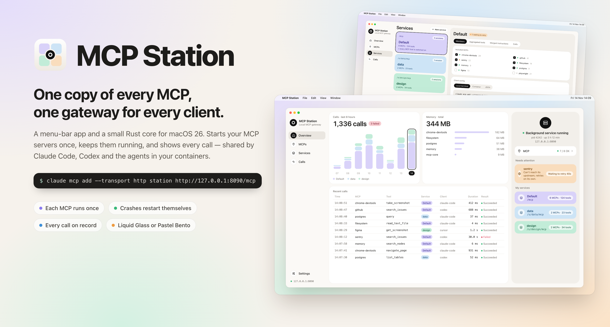
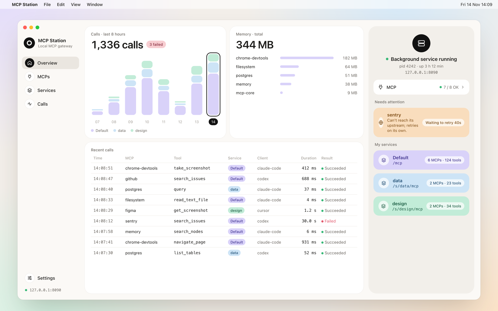
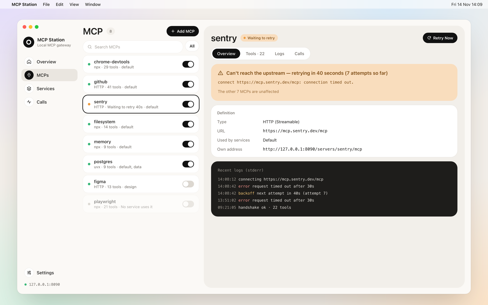
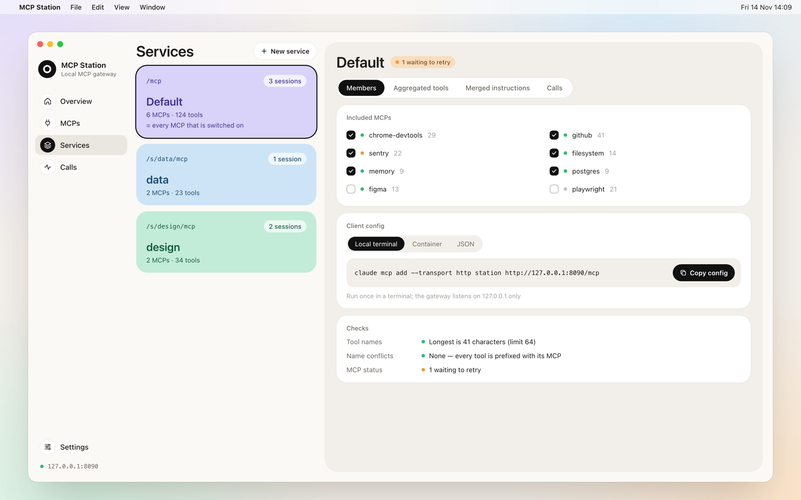
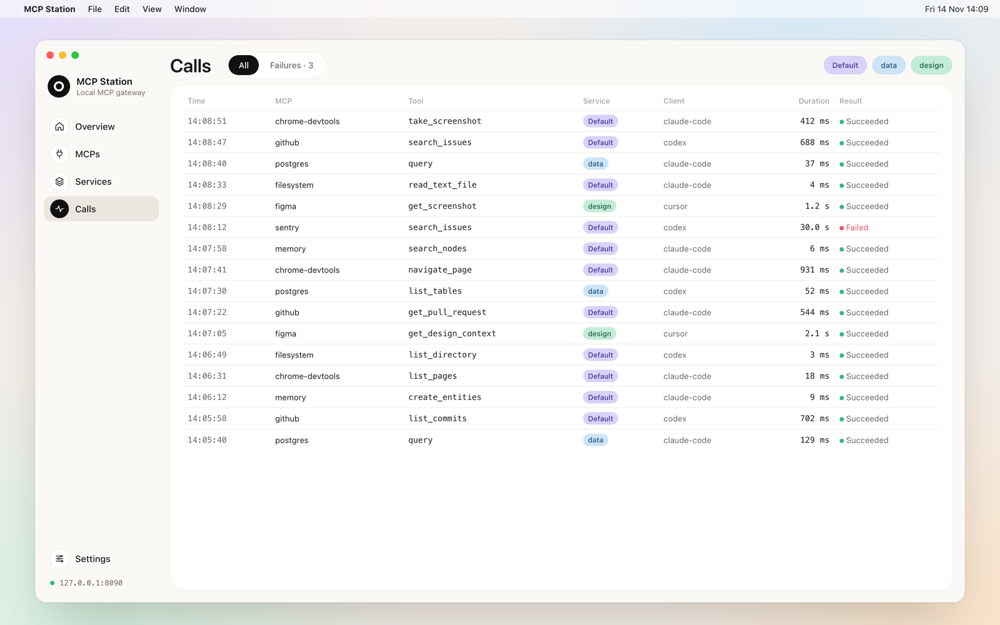
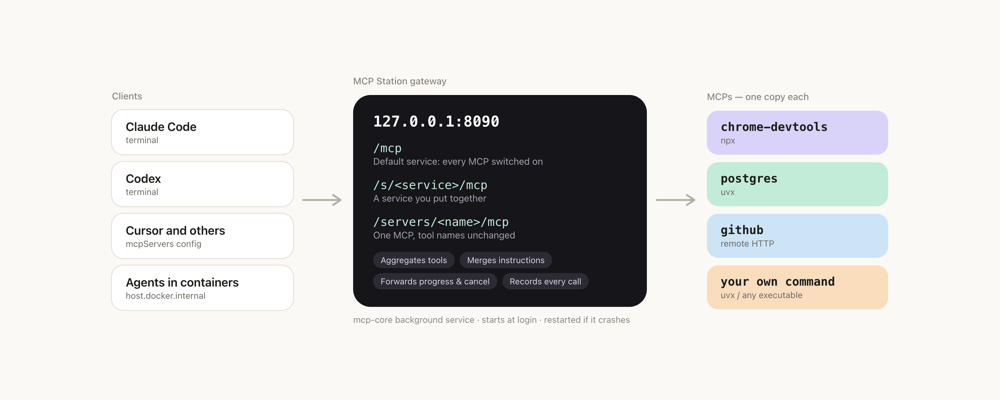

# MCP Station

**English** · [中文](README.zh-CN.md)



A local MCP gateway for macOS 26: a menu-bar app in Swift 6 and SwiftUI, and a
small background core in Rust.

You add your MCP servers once. MCP Station starts each of them once, keeps them
running, and puts all of them behind one address on `127.0.0.1`. Claude Code,
Codex, Cursor and the agents in your Docker containers all connect to that
address instead of each spawning their own copies.

## Why

Every MCP client starts its own copy of every MCP server. With three terminals,
an editor and a few containers, that is a dozen `npx` processes doing the same
thing, each configured separately, none of them visible when it breaks. When one
dies, you find out because a tool call fails.

This app exists to make that one process per server, configured in one place,
with a window that shows what is running and what every call did.

## What it does

- **One gateway, three kinds of address.** `/mcp` is the default service — every
  MCP that is switched on, with tool names prefixed `<mcp>__`. `/s/<service>/mcp`
  is a service you put together from a few MCPs. `/servers/<name>/mcp` is a single
  MCP with its tool names unchanged, so it can replace an existing address as is.
- **Aggregates properly.** Tools, prompts and resources from every member;
  each server's `instructions` merged under a heading; progress notifications and
  cancellations forwarded both ways.
- **Keeps servers alive.** Local commands (`npx`, `uvx`, any executable) and
  remote Streamable HTTP. A server that cannot start or loses its upstream is
  retried with backoff — 5 s, 15 s, 30 s, up to 5 minutes — and only that server
  is affected.
- **Shows its work.** State, tools, stderr and memory (sampled over the whole
  process tree) for each MCP; every call with its client, service, duration and
  result; a way to try a tool from the app.
- **Survives the app.** The gateway lives in `mcp-core`, a LaunchAgent that
  starts at login and is restarted if it crashes. Quitting the app does not
  disconnect anyone.
- **One JSON file.** `~/Library/Application Support/MCP Station/config.json`.
  Import the `mcpServers` block from Claude Code, Cursor and others; export it back.
- Two looks — **Liquid Glass** (plain native controls) and **Pastel Bento** —
  in English and Chinese, and updates through Sparkle.

## Four pages

| | |
| --- | --- |
|  **Overview** — calls per hour by service, memory, recent calls, and what needs attention |  **MCPs** — each server's state, definition, own address and recent stderr |
|  **Services** — which MCPs a service includes, and the command to connect a client |  **Calls** — every call through the gateway, newest first |

These are Pastel Bento. The illustrations are drawn from made-up servers by
[`design/readme/render.py`](design/readme/render.py), not captured from a real
screen.

## How it fits together



The app never talks to an MCP server itself. It manages `mcp-core` through a
small control API on a random loopback port (token-protected, address in
`runtime.json`), and `mcp-core` does the rest. A Windows front end could drive
the same API; the core is written with that in mind but has only been built on
macOS so far.

## What it does not do

No legacy SSE transport — clients use Streamable HTTP. No server-initiated
stream (`GET` returns 405), so `list_changed` is not passed on to clients. No
sampling, roots or elicitation. The config file is not watched; after editing it
by hand, restart the background service from the app. Secrets stay in `config.json` (mode
`0600`) rather than the Keychain.

## Requirements

macOS 26 or later. To build: Xcode 26 (Swift 6) and a Rust toolchain.

## Install

Download `MCP-Station.dmg` from [Releases](../../releases) and drag the app into
`/Applications`. The build is **not notarized**, so the first launch is refused by
Gatekeeper. Either open System Settings → Privacy & Security and click
**Open Anyway**, or clear the quarantine flag once:

```sh
xattr -dr com.apple.quarantine "/Applications/MCP Station.app"
```

On first launch the app installs `mcp-core` as a LaunchAgent and the gateway
starts on `127.0.0.1:8090` (change the port in Settings → Gateway).

Or build it yourself:

```sh
git clone https://github.com/yinminqian/mcp-station.git
cd mcp-station
scripts/build-app.sh --install    # builds build/MCP Station.app and copies it to /Applications
```

### Updates

The app checks for updates with [Sparkle](https://sparkle-project.org), reading
`appcast.xml` from this repository. The quarantine flag only has to be cleared
for the first install.

To publish a release, raise `VERSION`, commit, then:

```sh
PUBLISH=1 NOTES=notes.md scripts/release.sh
```

That runs both test suites, builds, makes the DMG, signs it with the EdDSA key in
your Keychain (`generate_keys --account mcp-station`) and publishes the GitHub
release and the appcast. Keep a backup of that key: without it, no installed copy
will accept another update.

## Connecting a client

Every service page has a **Copy config** button. For Claude Code:

```sh
claude mcp add --transport http station http://127.0.0.1:8090/mcp
```

From inside a Docker container, use `host.docker.internal` instead of
`127.0.0.1` — it keeps working when your network changes. For a client that
reads an `mcpServers` file:

```json
{ "mcpServers": { "station": { "type": "http", "url": "http://127.0.0.1:8090/mcp" } } }
```

## Security

The gateway listens on `127.0.0.1` only. It accepts the `Host` names
`localhost`, `127.0.0.1` and `host.docker.internal` (plus any you add), and
refuses any request carrying a browser `Origin` header — the DNS-rebinding
defence the MCP spec asks for.

There is **no token on the gateway itself**: any process running on your Mac, or
in a container that can reach `host.docker.internal`, can call every tool you
have switched on. That is the same trust a local `npx` server already has, and
it is why there is a per-MCP switch and per-service membership — expose only what
you would hand to an agent.

Child processes do not inherit your whole environment: they get a short
allow-list plus what you configure for them. Proxy variables in particular are
not passed on unless you add them.

## Architecture

| Path | Responsibility |
| --- | --- |
| `core/src/northbound.rs` | The gateway: Streamable HTTP, Host/Origin checks, session takeover |
| `core/src/router.rs` | Aggregation — tools, prompts, resources, instructions, progress and cancel |
| `core/src/registry.rs` | MCPs, services, routes, sessions, memory sampling |
| `core/src/upstream/` | One supervisor per server: stdio and HTTP, retries with backoff |
| `core/src/control.rs` | The control API the app uses, with an event stream |
| `core/src/platform/` | LaunchAgent, process groups, signals (Windows stubbed) |
| `app/Sources/MCPStation/Core/` | The app's client for the control API, and installing the core |
| `app/Sources/MCPStation/State/` | App state, navigation, language |
| `app/Sources/MCPStation/ThemeGlass/`, `ThemeBento/` | The two looks over the same state |

[`docs/ARCHITECTURE.md`](docs/ARCHITECTURE.md) has the full design and the
reasoning behind it (in Chinese).

## Tests

```sh
(cd core && cargo test)
(cd app && swift test)
```

`scripts/release.sh` runs both before it builds anything.

## Licence

MIT. See [LICENSE](LICENSE).
