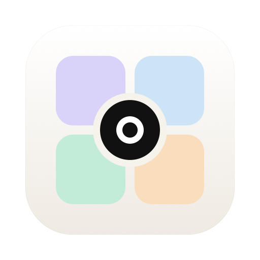

<p align="center"></p>

<h1 align="center">MCP Station</h1>

<p align="center">在 Mac 上统一管理和托管 MCP 的菜单栏应用：所有 MCP 只跑一份，Claude Code、Codex、Docker 容器里的客户端都连同一个本机网关。</p>

## 能做什么

- **一个网关，多种地址**：`/mcp`（默认服务，工具名带 `<MCP>__` 前缀）、`/s/<服务>/mcp`（自己挑几个 MCP 组成的服务）、`/servers/<名字>/mcp`（单个 MCP，工具名不变，可以直接替换现有地址）。
- **MCP 常驻、自动重连**：本地进程（npx / uvx / 命令）和远程 HTTP 都支持，连不上按退避自动重试。
- **看得见**：每个 MCP 的状态、工具、日志、内存（按进程树采样），每一次调用（谁调的、哪个服务、耗时、成败）。
- **试调用**：在 App 里直接调某个工具看返回。
- **配置就是一个 JSON 文件**：`~/Library/Application Support/MCP Station/config.json`，可以导入 Claude Code / Cursor 等的 `mcpServers`，也能导出。
- 两套界面：Liquid Glass（原生）和 Pastel Bento。

## 构建

需要 macOS 26 和 Xcode（Swift 6）。

```sh
scripts/build-app.sh            # 构建到 build/MCP Station.app
scripts/build-app.sh --install  # 构建并安装到 /Applications
```

网关默认监听 `127.0.0.1:8090`，端口在「设置 → 网关」里改。Docker 容器里用 `http://host.docker.internal:<端口>/...` 连。

改图标：编辑 `app/Resources/AppIcon.svg`，然后 `swift scripts/make-icon.swift`。

设计和取舍见 [docs/ARCHITECTURE.md](docs/ARCHITECTURE.md)。
