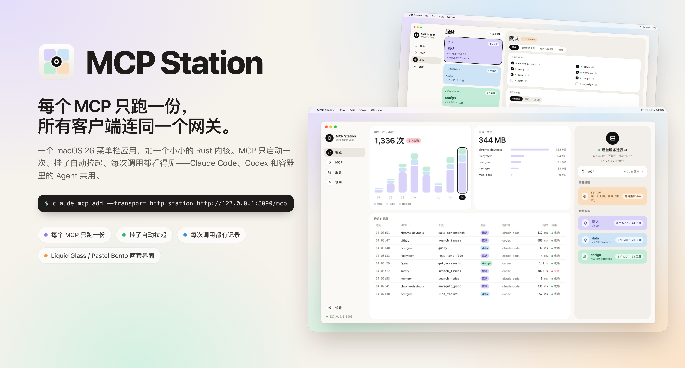
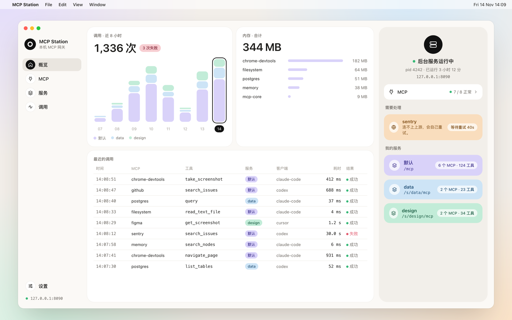
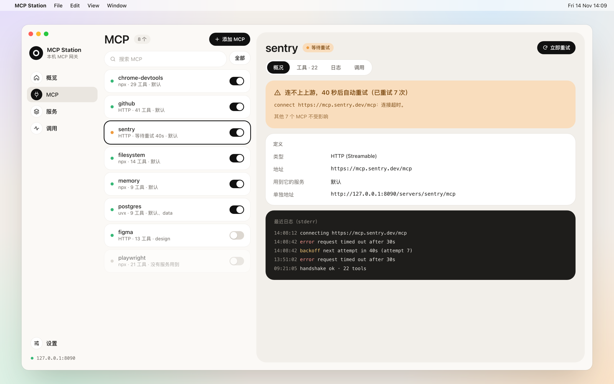
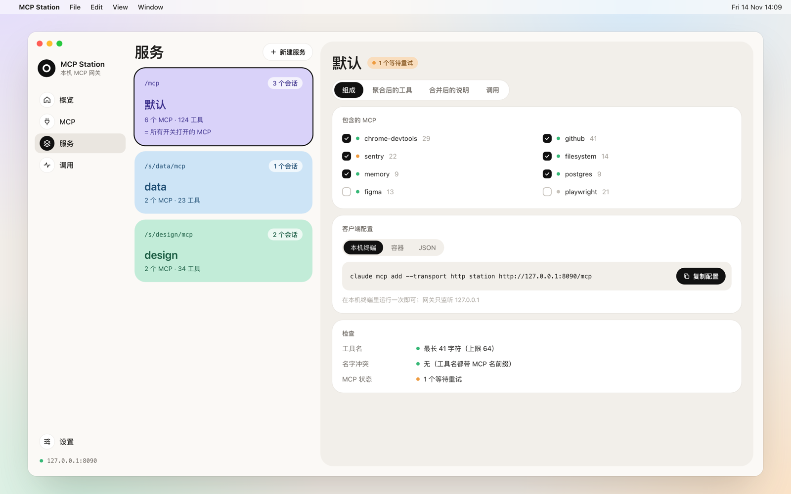
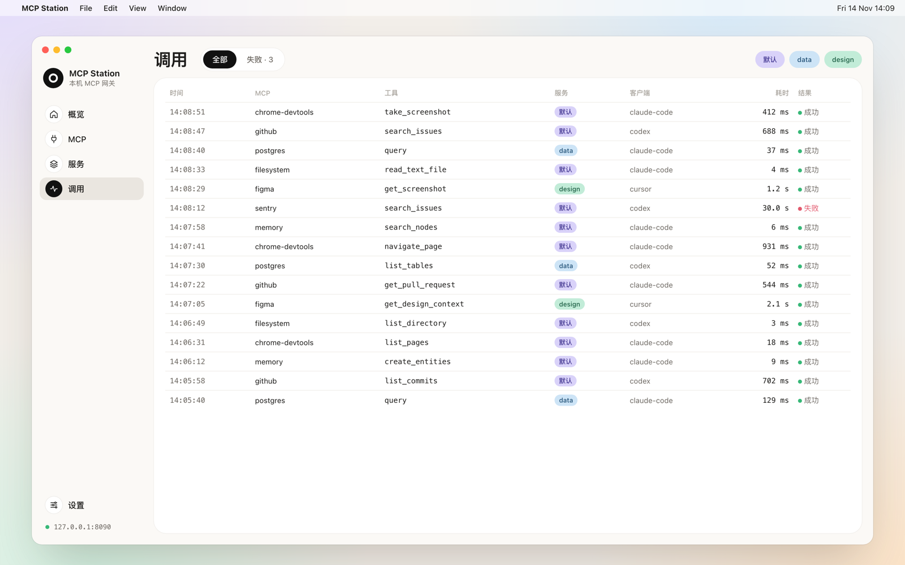
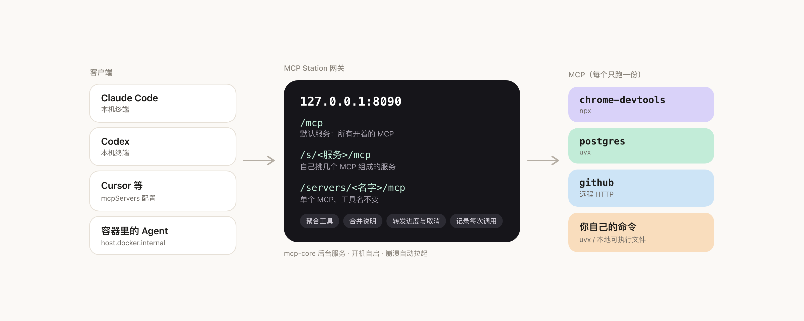

# MCP Station

[English](README.md) · **中文**



macOS 26 上的本机 MCP 网关：一个 Swift 6 / SwiftUI 写的菜单栏应用，加一个 Rust 写的小后台内核。

MCP 只需要添加一次。MCP Station 把每个 MCP 只启动一份、保持它一直在跑，并把它们都放在 `127.0.0.1` 上的同一个地址后面。Claude Code、Codex、Cursor 和 Docker 容器里的 Agent 都连这个地址，不再各自拉起一套。

## 为什么做

每个 MCP 客户端都会自己启动每个 MCP。开三个终端、一个编辑器、再加几个容器，就是十几个做同一件事的 `npx` 进程，每个都要单独配置，哪个挂了也看不见——直到某次工具调用失败才知道。

这个应用就是为了让每个 MCP 只有一个进程，只在一个地方配置，并且有个窗口能看到什么在跑、每次调用发生了什么。

## 能做什么

- **一个网关，三种地址。** `/mcp` 是默认服务——所有开关打开的 MCP，工具名带 `<MCP>__` 前缀。`/s/<服务>/mcp` 是你自己挑几个 MCP 组成的服务。`/servers/<名字>/mcp` 是单个 MCP，工具名不变，可以原样替换现有的地址。
- **聚合做全。** 合并所有成员的工具、prompts、resources；每个 MCP 的使用说明（`instructions`）加小标题后拼在一起；进度通知和取消请求双向转发。
- **MCP 常驻。** 本地命令（`npx`、`uvx`、任意可执行文件）和远程 Streamable HTTP 都支持。起不来或者连不上上游的，按退避重试——5 秒、15 秒、30 秒……最长 5 分钟——只影响它自己。
- **看得见。** 每个 MCP 的状态、工具、stderr、内存（按整棵进程树采样）；每一次调用的客户端、服务、耗时和结果；还能在 App 里直接试调某个工具。
- **退出 App 也不断。** 网关在 `mcp-core` 里，它是一个开机自启、崩溃自动拉起的 LaunchAgent。退出 App 不会断开任何客户端。
- **配置就是一个 JSON 文件。** `~/Library/Application Support/MCP Station/config.json`。可以导入 Claude Code、Cursor 等的 `mcpServers`，也能导出。
- 两套界面——**Liquid Glass**（系统原生控件）和 **Pastel Bento**——中英文，通过 Sparkle 自动更新。

## 四个页面

| | |
| --- | --- |
|  **概览**——按服务分的每小时调用数、内存、最近的调用、需要处理的事 |  **MCP**——每个 MCP 的状态、定义、单独地址和最近的 stderr |
|  **服务**——一个服务包含哪些 MCP，以及客户端要运行的那条命令 |  **调用**——经过网关的每一次调用，最新的在最上面 |

图里是 Pastel Bento 界面。这些插图由 [`design/readme/render.py`](design/readme/render.py) 用编造的 MCP 数据画出来，不是真实屏幕截图。

## 怎么组合在一起



App 自己从不直接和 MCP 打交道。它通过一个小的控制接口管理 `mcp-core`（随机的本机端口，带 token，地址写在 `runtime.json` 里），其余的都由 `mcp-core` 完成。以后的 Windows 界面可以接同一套接口；内核按跨平台的结构写的，但目前只在 macOS 上编译过。

## 不做什么

不支持旧的 SSE 传输——客户端用 Streamable HTTP。不提供服务器推送流（`GET` 返回 405），所以 `list_changed` 不会转给客户端。不支持 sampling、roots 和 elicitation。不监听配置文件变化；手改之后在 App 里重启一下后台服务。密钥放在 `config.json`（权限 `0600`），不进钥匙串。

## 环境要求

macOS 26 及以上。自己编译需要 Xcode 26（Swift 6）和 Rust 工具链。

## 安装

从 [Releases](../../releases) 下载 `MCP-Station.dmg`，把 App 拖进「应用程序」。这个包**没有做苹果公证**，第一次打开会被系统拦下：到「系统设置 → 隐私与安全性」点「仍要打开」，或者在终端清掉隔离标记（只需一次）：

```sh
xattr -dr com.apple.quarantine "/Applications/MCP Station.app"
```

第一次打开时，App 会把 `mcp-core` 装成 LaunchAgent，网关在 `127.0.0.1:8090` 上启动（端口在「设置 → 网关」里改）。

也可以自己编译：

```sh
git clone https://github.com/yinminqian/mcp-station.git
cd mcp-station
scripts/build-app.sh --install    # 构建到 build/MCP Station.app 并装进 /Applications
```

### 更新

App 用 [Sparkle](https://sparkle-project.org) 检查更新，读的是本仓库里的 `appcast.xml`。隔离标记只需要在第一次安装时清一次。

发布新版本：改 `VERSION`，提交，然后：

```sh
PUBLISH=1 NOTES=notes.md scripts/release.sh
```

它会先跑两边的测试，再构建、做 DMG、用钥匙串里的 EdDSA 私钥签名（`generate_keys --account mcp-station`），最后发布 GitHub Release 和 appcast。这把私钥要备份好：丢了的话，已经装上的 App 再也收不到更新。

## 连接客户端

每个服务页都有「复制配置」按钮。Claude Code 的写法：

```sh
claude mcp add --transport http station http://127.0.0.1:8090/mcp
```

在 Docker 容器里，把 `127.0.0.1` 换成 `host.docker.internal`——换网络也不受影响。读 `mcpServers` 文件的客户端这样写：

```json
{ "mcpServers": { "station": { "type": "http", "url": "http://127.0.0.1:8090/mcp" } } }
```

## 安全

网关只监听 `127.0.0.1`。`Host` 只认 `localhost`、`127.0.0.1` 和 `host.docker.internal`（加上你自己配置的），带浏览器 `Origin` 头的请求一律拒绝——这是 MCP 规范要求的防 DNS rebinding 措施。

**网关本身没有 token**：你 Mac 上的任何进程，或者能访问 `host.docker.internal` 的容器，都能调用你打开的所有工具。这和一个本地 `npx` MCP 本来就有的信任级别一样，也正因为如此才有每个 MCP 的开关和每个服务的成员勾选——只暴露你愿意交给 Agent 的东西。

子进程不会继承你的全部环境变量：只拿一份很短的白名单，加上你给它配置的。特别是代理相关的变量，除非你自己加上，否则不会传下去。

## 代码结构

| 路径 | 职责 |
| --- | --- |
| `core/src/northbound.rs` | 网关：Streamable HTTP、Host / Origin 检查、会话接管 |
| `core/src/router.rs` | 聚合：工具、prompts、resources、使用说明、进度和取消 |
| `core/src/registry.rs` | MCP、服务、路由、会话、内存采样 |
| `core/src/upstream/` | 每个 MCP 一个守护：stdio 和 HTTP，退避重试 |
| `core/src/control.rs` | App 用的控制接口，带事件流 |
| `core/src/platform/` | LaunchAgent、进程组、信号（Windows 先留了桩） |
| `app/Sources/MCPStation/Core/` | App 这边的控制接口客户端，以及安装内核 |
| `app/Sources/MCPStation/State/` | 应用状态、导航、语言 |
| `app/Sources/MCPStation/ThemeGlass/`、`ThemeBento/` | 同一份状态上的两套界面 |

完整的设计和取舍见 [`docs/ARCHITECTURE.md`](docs/ARCHITECTURE.md)。

## 测试

```sh
(cd core && cargo test)
(cd app && swift test)
```

`scripts/release.sh` 在构建前会先跑这两套。

## 许可证

MIT，见 [LICENSE](LICENSE)。
